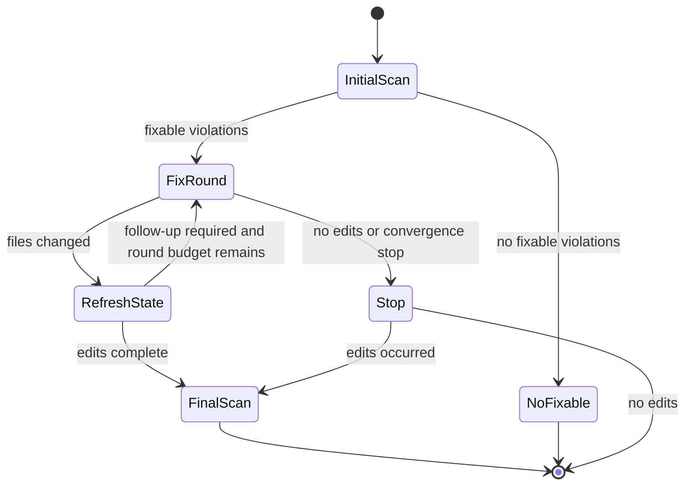

# Check and Fix Engine

`src/style/engine.rs` owns the lifecycle. The facade in `src/style.rs` exposes its entrypoints to the CLI. `run_check` resolves files through `workspace::resolve_files`, collects rule outcomes, and returns a `RunSummary`. `run_fix` snapshots every selected source file, performs an initial scan, applies up to `MAX_TUNE_ROUNDS` rounds, refreshes state for changed files, and performs a final scan when at least one edit was applied. If an internal error occurs after writes, the command restores the command-start snapshot; the complete contract is [tune failure atomicity](../specifications/tune-failure-atomicity.md).

The engine groups work into file/package scopes. Checking can use Rayon; fix scopes run in parallel only when more than one scope exists and their selected file sets are disjoint. `CheckState` keeps per-file counts and updates aggregate violation and manual-fix counts by subtracting the prior file entry before adding the refreshed one.

Fix collection produces `Edit` ranges. `src/style/fixes.rs` applies compatible edits, while rule-specific metadata records import fallback, `let mut` reorder, and type-alias rename follow-up work. Overlapping edits are deferred rather than blindly composed; [derive interaction](../specifications/style-import-derive-interactions.md) specifies the important derive case.

## Edit and binding boundaries

`types/renames.rs` owns `TypeAliasRenamePlan`. It plans definition and reference edits from module-qualified type bindings before the engine applies per-file passes. The engine owns snapshots, compiler validation, and recovery; alias name resolution stays with the type policy.

`shared::item_text_range` extends a syntax span to its physical lines only when both the leading and trailing text are whitespace. Otherwise, removal and reorder operations use the exact syntax span. This keeps adjacent declarations and enclosing braces when multiple items share one line. `fixes.rs` finds protected string, byte, C-string, and character ranges from parser tokens, so literal prefixes are protected and Unicode lifetimes remain code.

Cargo validation covers the selected build configuration. The integration regressions compare original and tuned program output for binding-sensitive changes and verify that test discovery retains inline test functions. Additional configurations and runtime contracts need their own tests.

## Ownership and test scope

`workspace.rs` owns package and feature selection, Git-ignore discovery, and process-local discovery caches. `rules.rs` dispatches Rust checks; `shared.rs` owns source contexts and diagnostics. The engine keeps transaction records and recovery state together. It permits four tune rounds and eight per-file fix passes. A scan with no fixable violations returns before fix or compiler-validation rounds.

The regression modules in `src/style/tests/` are private test children of the engine, so they can verify internal transactions without exposing helpers to production callers. Integration targets in `tests/` verify real binary behavior and share temporary-directory ownership in `tests/support/fixture.rs`.

## Change recipes

For a new fix, add the detector/edit producer in its rule family, ensure the edit is represented in the file outcome and any required semantic fallback, then add a fixture test that asserts both source result and remaining diagnostics. For lifecycle changes, update the stop conditions and tests around initial, unchanged, multi-round, and failed-validation paths. Narrow checks include `cargo test --test let_mut_reorder --test type_alias_rename` and `cargo test --test pub_use_self_group`; use the full all-target test only when shared orchestration changes broadly.
