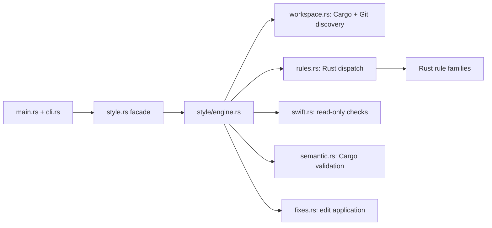

# Architecture Overview

`vibe-style` is one Cargo package with two binaries, `vstyle` and `cargo-vstyle`, both built from `src/main.rs`. The executable owns CLI parsing and delegates to the `style` module; the style module selects files, runs language-specific detectors, formats stable rule diagnostics, and optionally applies deterministic edits.

## Composition

`src/style.rs` is a small CLI facade. `engine.rs` owns scans, fix rounds, state refresh, and transaction recovery. `workspace.rs` owns Cargo metadata, package selection, Git-ignore discovery, and process-local discovery caches. `shared.rs` owns source contexts, diagnostics, edit records, and the 42-entry rule registry: 36 Rust IDs and six Swift IDs. `syntax.rs` owns common token and path helpers, AST import bindings, and generic-parameter names. `module_tree.rs` owns declared file-module identity, including `#[path]` declarations and test-only contexts; import policies and type-alias planning share it. The complete ID-to-backend classification is canonical in [style rule backends](../specifications/style-rule-backends.md).

Rule families are split by responsibility: `file.rs`, `module.rs`, `imports.rs`, `impls.rs`, `generics.rs`, `types.rs`, `bindings.rs`, `quality.rs`, `spacing.rs`, and `test_modules.rs`; Swift has its separate source-text backend in `swift.rs`. `rules.rs` dispatches Rust families. `imports.rs` coordinates policies through child modules: `paths`, `references`, `scopes`, `groups`, and `analysis` own mechanisms; `aliases`, `qualification`, `shortening`, and `derives` own policies; `planning` shares their order with `local` module processing. Private plan records remain in the import coordinator. Compiler-backed validation is isolated in `semantic.rs` and invokes Cargo for each check.

`types/renames.rs` owns the type-alias rewrite plan. It matches module-qualified type identities, respects generic shadows, and preserves private target paths. It leaves bare values, enum variants, and macro names in their own namespaces. Ambiguous conditional definitions and unsupported import-owner changes remain manual cases; selected-configuration Cargo checks remain the engine's validation gate.

## Change navigation

- Change command parsing or exits in [CLI](cli.md), then run the focused CLI tests.
- Change discovery, edit conflict handling, rounds, or convergence in [Engine](engine.md).
- Change a rule contract or registration in [Rules](rules.md) and the normative [backend specification](../specifications/style-rule-backends.md).
- Change compiler validation or recovery in [Semantic validation](semantic-validation.md).
- Change Swift checks only within [Swift](swift.md) and its [applicability specification](../specifications/swift-style-rule-applicability.md).

The package has no separate public library entrypoint: consumers use the binaries or the Cargo subcommand. Release and Action packaging are documented in [testing and automation](testing-and-automation.md).
