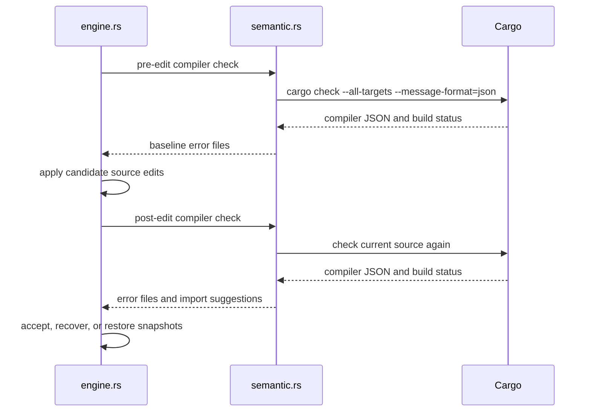

# Semantic Validation

`src/style/semantic.rs` is the compiler boundary. It invokes `cargo check --all-targets --message-format=json`, extracts compiler-error files and missing-import suggestions, and validates changes that can alter binding semantics. `src/style/engine.rs` supplies baseline and post-edit error sets to its fallback logic, while the whole-command restore boundary is specified in [tune failure atomicity](../specifications/tune-failure-atomicity.md).

## Lifecycle

`VSTYLE_MAX_IMPORT_SUGGESTION_ROUNDS` is read once: missing uses `2`, invalid text or `0` uses `2`, values above `16` use `16`, and valid values from `1..=16` are honored. Each check starts a Cargo subprocess. Cargo owns incremental reuse and invalidation for companion sources, manifests, dependencies, and build scripts. vstyle does not persist compiler output or report cache-hit counters. The changed-companion regression in `tests/let_mut_reorder.rs` ensures a later invalid source cannot be hidden by an earlier successful validation.

Compiler output is scoped back to selected style files. Import suggestions are applied only to those files and are bounded by the round setting. A semantic-positive change must test both the baseline-error and post-edit paths; a no-op self-tune does not exercise semantic validation. A missing build-finished status is an execution error, not a successful empty diagnostic set.

## Validation

Use `cargo make bench-semantic-vstyle` for semantic changes. The harness builds `final-release` by default, creates a temporary fixture with safe and unsafe `let mut` cases, records cold and warm tune timings with actual Cargo validation on both runs under `target/vstyle-bench-semantic/`, and removes the fixture. Use `cargo test --test let_mut_reorder` for focused behavioral evidence. Release-wide evidence is separate in [benchmark tracking](../runbooks/benchmark-tracking.md).
